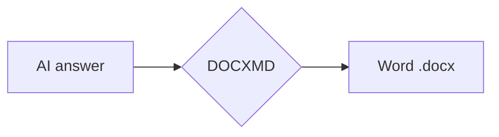

# DOCXMD — Markdown ↔ Word for VS Code

**Private offline Markdown ↔ Word converter for researchers, students, technical writers and ChatGPT/AI users.**

Write Markdown in VS Code with a live preview and get a real Word document: native equations, citations and a reference list, numbered diagrams, tables, footnotes, headers and page numbers. Import Word back to Markdown. Everything runs locally; nothing is uploaded.


## Why DOCXMD

- **ChatGPT / AI answer → Word.** Paste an answer from ChatGPT, Claude, Gemini, Copilot, Perplexity or DeepSeek. Formulas in `[ … ]` / `( … )`, broken tables and `【4†source】` marks are repaired automatically. Use the **DOCXMD: Paste from AI** command to paste the clipboard text.
- **Real Word equations.** LaTeX (`$…$`, `\(…\)`, `$$…$$`, `\[…\]`) becomes native, editable Word math (OMML), including matrices, `cases`, sums and integrals with limits, accents and `\mathbb`.
- **Citations and bibliography, Pandoc-style.** Write `[@key]`, `[@key, p. 12]`, `@key` or `[-@key]`, and put `[BIB]` (or `::: {#refs}`) where the reference list goes. Sources come from a ```` ```bibtex ```` block or from `bibliography: refs.bib` (BibTeX, RIS or CSL-JSON next to the file). Styles: `csl: apa | ieee | dstu-8302 | vancouver | harvard | chicago | mla`, or your own `.csl` file. Optionally, the Word export keeps live **Zotero** fields (setting `docxmd.zoteroFields`).
- **Mermaid diagrams.** ```` ```mermaid ```` blocks (flowchart, sequence, class, state, ER, Gantt, pie, mind map, timeline) render in the preview and export to Word as numbered, captioned vector pictures. Importing the Word file gives you the Mermaid code back.
- **Word → Markdown.** Import `.docx` with table colours, merged cells, pictures, footnotes, numbering and citations (Zotero, Mendeley, Word) kept.
- **A comfortable editor.** Split / Source / Preview modes, editing in the preview (as in Typora), an outline panel, find & replace with regular expressions, a formatting toolbar, 4 themes and 4 interface languages.
- **Private and offline.** The renderer, KaTeX, citeproc and Mermaid are bundled with the extension. Only translation (DeepL, with your own key) uses the network.

## Who it is for

- **Researchers and students:** theses, papers and reports with equations, figures and a reference list in DSTU 8302, APA or IEEE, delivered as `.docx`.
- **Technical writers and developers:** documentation in Markdown and Git, with Word files for the people who need them.
- **ChatGPT and AI users:** an AI answer becomes a clean Word report in one paste.

## Quick start

1. Open any `.md` file. DOCXMD Editor opens it with a live preview.
2. Write, or run **DOCXMD: Paste from AI** to paste an answer from your chat.
3. Press **DOCX** in the toolbar (or run **DOCXMD: Export to Word (.docx)**).

~~~markdown
---
title: Review
csl: apa
---

Typesetting is solved [@knuth1984, p. 12]. The roots are $x = \frac{-b \pm \sqrt{b^2-4ac}}{2a}$.



## References

[BIB]

```bibtex
@book{knuth1984, author = {Knuth, Donald E.}, title = {The {TeXbook}}, publisher = {Addison-Wesley}, year = {1984}}
```
~~~

## Screenshots

The extension's editor uses the same interface, themes and converter as the [DOCXMD web app](https://docxmd.pp.ua/); these screenshots come from its illustrated guide.

| | |
|---|---|
|  |  |
| **Formatting toolbar** — bold, x² / x₂, Ω symbols, headings, callouts, lists, links, images, tables, alignment | **Find & replace** — every match highlighted in the source and the preview |
|  |  |
| **Callout blocks** `:::warning` / `> [!NOTE]` — kept as tinted boxes in Word | **Colour boxes** `:::red … :::` |
|  |  |
| **Footnotes, numbered figures & tables, cross-references, table of contents** | **HTML styling** — the source on the left, the result on the right |
|  |  |
| **Translate** into English · Українська · Español · 中文 | **4 themes · 4 interface languages** |


## All features


- Custom editor for `.md` and `.markdown` files — DOCXMD Editor is the default editor for these file types.
- **Smart editing** — `Enter` continues lists, quotes and table rows, `Tab` / `Shift+Tab` change list levels and move between table cells, `Alt+↑/↓` move lines, selected text is wrapped by `*` `=` `~` … — in the source **and in Preview mode**. See [Keyboard shortcuts](#keyboard-shortcuts).
- **Smart paste** — text copied from Word, Google Docs or a web page becomes Markdown; a URL pasted onto selected text becomes a link; `Ctrl+Shift+V` pastes plain text.
- **Markdown syntax highlighting, line numbers and the current line** in the editor (Document menu → Editor).
- **Align table** (`Ctrl+Shift+T`) — straight columns in the pipe table under the cursor.
- **Tables in Preview mode** — hover a table: drag column borders (widths), the right edge (table width) and row edges (row height); a small bar places the table left / centre / right, aligns cell content (cell, row, column or table × 9 positions), makes columns equal or resets sizes. A Markdown pipe table becomes an HTML table on the first change.
- **Font, size and colour** (toolbar **Aa** / size / **A**) — selected text gets `<span style="font-size:14pt">…</span>` (a second choice updates the same span); nothing selected → the whole document via front matter `font:` / `font-size:`. Works in the source, the ✎ block editor and Preview mode; exported to Word as real run formatting and default font / size.
- Live preview with synchronized Markdown source and rendered document.
- Formatting toolbar for common Markdown editing operations.
- **Text & image alignment** (left / center / right / justify) — in the source and in Preview mode; any alignment replaces the previous one; renders in the preview and is honoured on DOCX export.
- **UPPERCASE / lowercase** (toolbar **AA** / **aa**) — of the selected text, in the source, the ✎ block editor and Preview mode.
- **Insert images** by pasting (`Ctrl+V`) or dragging a file onto the editor — saved to `images/` next to the document with a relative link (or embedded as a data-URI: setting `docxmd.pastedImages`, and always for untitled documents).
- **Clean up scientific notation** — MinerU/LaTeX leftovers, chemical formulas and units, reviewed in a list before anything changes.
- **Highlights** `==text==`, `==red:text==` — Word text highlighting in DOCX.
- **Front matter** — `header`, `footer`, `page-numbers`, `title`, `author` become a real Word header / footer, PAGE / NUMPAGES fields and document properties.
- **Find & replace** (`Ctrl+F`) with every match highlighted in both the source and the preview; regular expressions with `$1` groups, match case, whole word, **Replace** / **Replace all** (one `Ctrl+Z` undoes it).
- **Outline** panel (button at the left of the toolbar): all headings with their numbers, follows the scroll, click to jump.
- **Editing in the preview** (as in Typora): click a paragraph, heading, list item or table cell to edit its text in place; ✎, double-click or `Alt+click` edits the Markdown of a whole block.
- **Document menu**: table of contents `[TOC]`, numbered headings, footnote, figure / table caption, clean up notation, **statistics** (also a click on the word counter), **export to HTML** (formulas as MathML — no external files needed).
- **Interface in English, Українська, Español, 中文** — follows VS Code's display language.
- **Status bar** with live word / character / line / reading-time counts, a scroll-position indicator and quick navigation (start / end / click-to-jump).
- **LaTeX math** — inline `\(…\)` or `$…$` and display `\[…\]` / `$$…$$` formulas rendered with KaTeX (offline), and exported to Word as **native editable equations** (OMML).
- **Colour boxes** — wrap text or a quote in `:::red … :::` (or `:::green`, `:::#ff8800`, Ukrainian names like `:::червоний`) to give it a coloured bar in the preview and in Word.
- **Import Word (`.docx`) to Markdown** — keeps table cell fills, text colours and horizontal/vertical alignment, merged cells, superscripts/subscripts and images.
- **Styled tables** — HTML tables with inline `style` (background, colour, `text-align`, `vertical-align`, `colspan`/`rowspan`) export to Word with the same formatting.
- **Translate documents** into the interface languages (English · Українська · Español · 中文) with DeepL.
- **Spell-checking** (toolbar **A✓**) — misspelled words in the preview get a red wavy underline; click one for suggestions (the pick replaces the word in the Markdown, one `Ctrl+Z` undoes it) or **Add to my dictionary**. Hunspell runs on your computer; Ukrainian, Russian, English (US and British), Spanish, Portuguese, German, French, Polish and Italian. The document language comes from front matter `lang:` or is detected; Cyrillic and Latin quotations are checked in their own alphabet. Code, formulas, abbreviations and the front matter are skipped.
- **Help** button — opens the full illustrated guide in your browser.
- 4 themes for the editor and preview.
- Split / Source / Preview modes.
- Export to Word (`.docx`) — use the `DOCXMD: Export to Word (.docx)` command or the DOCX button.
- Import Word (`.docx`) — use the `DOCXMD: Import Word (.docx) to Markdown` command or the Explorer context menu on a `.docx` file.
- Two-way synchronization with the VS Code document — minimal edits, precise undo, no lost keystrokes.
- Synchronized scrolling of the source and the preview in Split mode.
- External file changes automatically refresh the editor.
- The built-in VS Code Markdown editor remains available through **Open With…** when needed.

- **Paste from AI** — an AI answer pasted with `Ctrl+V` is repaired automatically (a notice reports the fixes; `Ctrl+Z` undoes it); the **DOCXMD: Paste from AI** command pastes the clipboard text.
- **Citations** `[@key]` with BibTeX / RIS / CSL-JSON and CSL styles (citeproc-js, offline); **Zotero fields** in the Word export (`docxmd.zoteroFields`); Zotero, Mendeley and Word citations back to `[@key]` on Word import.
- **Mermaid diagrams** in the preview and in Word (vector SVG with a PNG fallback), numbered as figures with `{#fig:id caption="…"}`.

## Keyboard shortcuts

On macOS use `Cmd` instead of `Ctrl`. Editing keys work in the Markdown source, in the ✎ block editor and — where noted — in the quick text edit of Preview mode.

| Keys | Action |
|---|---|
| `Ctrl+S` | Save the document (always the latest text) |
| `Ctrl+F` | Find & replace; `Enter` / `Shift+Enter` — next / previous match, `Ctrl+Enter` in the replace field — Replace all |
| `Alt+R` / `Alt+C` / `Alt+W` | In the find bar: regular expressions / match case / whole word |
| `Esc` | Close the find bar, a dialog or a menu |
| `Ctrl+Z` / `Ctrl+Y` | Undo / redo (VS Code's own undo stack, one step per edit) |
| `Ctrl+Shift+H` | Highlight the selection `==…==` |
| `Ctrl+.` / `Ctrl+,` | Superscript / subscript |
| `Enter` | Continue a list, task list, quote or table row; on an empty item — one level out / end the list. Preview: new list item, or split the paragraph |
| `Tab` / `Shift+Tab` | List item one level deeper / higher; next / previous table cell (a new row after the last one); indent / outdent selected lines; otherwise 4 spaces. Also in Preview |
| `Alt+↑` / `Alt+↓` | Move the current lines. Preview: move a list item, a table row or a whole block |
| `Shift+Alt+↑` / `Shift+Alt+↓` | Duplicate the current lines |
| `Ctrl+/` | Comment out / in with `<!-- -->` |
| `Ctrl+Shift+T` | Align the table under the cursor |
| `Ctrl+V` / `Ctrl+Shift+V` | Paste (images are saved to `images/`, formatted text becomes Markdown, a URL on selected text becomes a link) / paste plain text |
| `*` `_` `` ` `` `=` `~` `(` `[` `"` | With text selected: wrap it — `*…*`, `==…==`, `~~…~~`, `` `…` ``; another `*` makes it bold |
| `Ctrl+B` / `Ctrl+I` | Bold / italic. In Preview: switches bold / italic of the selected text on and off (same as the **B** / **I** buttons), also in HTML tables and imported text |
| `Esc`, then `Tab` | Leave the editor with the keyboard (`Tab` is otherwise captured) |
| Click · ✎ / double-click / `Alt+click` | Preview: edit text in place · edit the Markdown of a whole block |
| `Shift+Enter` · `Ctrl+Enter` | Apply the quick edit · apply the block editor (`Esc` cancels) |
| `Enter` at a hard line break | Preview quick edit: split the paragraph right there (the break marker is removed) |

## Usage

### Open a Markdown file

Open any `.md` or `.markdown` file normally in VS Code. DOCXMD Editor is configured as the default editor, so a normal double-click opens the document in DOCXMD.

You can also right-click the file and select **Open With… → DOCXMD Editor**. To use the built-in VS Code Markdown editor instead, select it from **Open With…**.

### Edit Markdown

Edit the Markdown document directly in DOCXMD. Changes are synchronized with the underlying VS Code document and can be saved normally with:

- `Ctrl+S` on Windows/Linux
- `Cmd+S` on macOS

### Export to Word

Click **DOCX** in the editor toolbar, or open the Command Palette and run:

```
DOCXMD: Export to Word (.docx)
```

Choose the destination filename and save the generated Word document.

### Import Word (.docx)

Right-click a `.docx` file in the Explorer and choose **DOCXMD: Import Word (.docx) to Markdown**, or run the same command from the Command Palette. Pick where to save the new `.md`; it opens in DOCXMD with the converted content and is saved automatically.

Tables keep their look: cell fills, text colours and alignment (horizontal and vertical) are written as an HTML table with inline styles, because a Markdown pipe table cannot hold colours. Plain tables whose only formatting is per-column alignment stay pipe tables with `:-:` / `--:` markers. Quotes exported by DOCXMD come back as `>` quotes — or as `:::colour` boxes when their bar is coloured.

### Colour boxes

```markdown
:::red
> 1. **Core-Peripheral gradients:** one point is the core temperature.
:::

:::green
2. **Temperature range** — works without `>` too.
:::

:::#ff8800
> 3. **Statistical features:** mean and standard deviation.
:::
```

Names: `red`, `orange`, `yellow`, `green`, `teal`, `blue`, `purple`, `pink`, `gray`, `black` (and Ukrainian: `червоний`, `помаранчевий`, `жовтий`, `зелений`, `бірюзовий`, `синій`, `блакитний`, `фіолетовий`, `рожевий`, `сірий`, `чорний`), or any `#RRGGBB` / `#RGB`. A box around a `>` quote does not draw a second bar. An unknown name stays plain text. Plain `>` quotes use the accent colour of the current theme, in the preview and in the exported `.docx`.

### Find & replace

Press `Ctrl+F` (or the 🔍 button) to open the find bar. Type a query and press `Enter`; every match is highlighted — the current one in the accent colour, the rest in yellow — in the source and the preview. `Enter` / `Shift+Enter` move to the next / previous match. Toggle **.\*** (regular expression, `Alt+R`), **Aa** (match case, `Alt+C`) and **W** (whole word, `Alt+W`). In the replace field `Enter` replaces the current match, `Ctrl+Enter` replaces all; with regular expressions `$1`, `$<name>` and `$&` insert groups — e.g. find `T(Core|Periphery)`, replace `T<sub>$1</sub>`. Every replacement is undoable.

### Alignment & images

Use the alignment buttons in the toolbar to wrap the current block in `<div align="…">` (left / center / right / justify). In Preview mode they align the block under the caret or every block the selection touches. Another alignment **replaces** the wrapper (never nests it), and alignment written inside the block (e.g. `<p style="text-align:left">` from a Word import) is replaced too; **left** removes it. **Justify** works like Word: every line except the last one of a paragraph is stretched — also lines that end in a hard line break (two spaces, `\` or `<br>`) — so a one-line paragraph still looks left-aligned. Paste an image from the clipboard with `Ctrl+V`, or drag an image file onto the editor — it is written to `images/image-001.png` (the next free number) in the folder of the `.md` and a relative link `` is inserted. Set `docxmd.pastedImages` to `embed` to keep the old behaviour (a base64 data-URI inside the text); untitled documents always embed.

### Clean up scientific notation

Run **DOCXMD: Clean up scientific notation** (or the flask button in the toolbar). Choose the output — `<sub>/<sup>` tags (recommended, real indices in Word) or Unicode ₂ ² — and review the proposed changes: identical changes are grouped (×N), untick what should stay. The rules: simple formulas `$T_{Core}$`, `$\Delta$`; MinerU index artefacts `T _ { Core }`, `R ^ { 2 }`, `R^2`; a dictionary (`CO2`, `SpO2`, `H2O`, `HbA1c`, `TCore`… — edit it in the `docxmd.notationDictionary` setting); a space between a number and its unit (`36.7°C` → `36.7 °C`). Code, `$$…$$`, links, URLs, HTML and front matter are never touched; complex formulas (`\frac`, roots, sums, nested indices) stay as they are. The whole clean-up is one edit — one `Ctrl+Z` restores the text.

### Highlights and front matter

`==important==` is highlighted in yellow; `==red:…==`, `==green:…==`, `==blue:…==`, `==pink:…==`, `==gray:…==` pick a colour (toolbar button or `Ctrl+Shift+H`). In Word they are real text highlights, and importing a `.docx` brings them back.

A YAML block at the very top of the file controls the Word document:

```yaml
---
title: Non-invasive biomarkers
author: KOLIBRI MEDICAL TECHNOLOGY
lang: en
header: KOLIBRI MEDICAL TECHNOLOGY — {title}
footer: Confidential • 2026
page-numbers: "Page {n} of {N}"
---
```

`header` / `footer` become the Word header and footer, `{n}` / `{N}` the PAGE / NUMPAGES fields (`page-numbers: true` prints just the number), `title` / `author` / `subject` / `keywords` the document properties, and `lang` the language of the "Figure / Table" words. The preview shows the block as a compact card. Importing a `.docx` turns its header, footer and page numbers back into front matter.

### LaTeX math

Formulas render live with **KaTeX** (bundled, works offline). Use inline `\(…\)` or `$…$` and display `\[…\]` or `$$…$$`, e.g. `\[ E = mc^2 \]`. For `$…$` the Pandoc rules apply: no space right after the opening `$` or before the closing one, and no digit right after it — so prices like "$5 and $10" stay plain text; write `\$` for a literal dollar.

### Translate

Pick a target language from the **🌐 Translate…** menu in the toolbar (English · Українська · Español · 中文). The translation preserves the Markdown structure, tables, links and code, and opens as a new untitled document.

Translation uses **DeepL** and requires your own API key. On first use you will be asked for it; it is stored in the `docxmd.deeplApiKey` setting and sent only to DeepL. If the key's monthly quota is used up (or the key is rejected), a dialog lets you enter another key and the translation continues; you can also run **DOCXMD: Set DeepL API key** at any time. Get a free key at <https://www.deepl.com/pro-api>.

### Spell-checking

The **A✓** button in the toolbar turns it on or off (on by default). Misspelled words in the preview are underlined; click one to pick a suggestion or add the word to your dictionary (kept per language in VS Code). Each dictionary (0.5–8 MB) is downloaded once, the first time a document needs it, from `https://docxmd.pp.ua/models/dict/` and kept in the extension's storage; the text being checked never leaves VS Code. Set `lang: de` (or `en-GB`, `uk`, …) in the front matter to choose the language yourself.

### Help

Click the **?** button to open the full illustrated guide (screenshots, HTML-styling recipes, smart editing and all keyboard shortcuts) at <https://docxmd.pp.ua/?help=1> in your browser.

## Editor Modes

DOCXMD supports three editor modes:

- **Split** — Markdown source and live preview side by side.
- **Source** — Markdown source only.
- **Preview** — rendered document only.

## Themes

The editor includes four built-in visual themes for the editing and preview environment.

## Markdown Rendering

DOCXMD uses local copies of its Markdown rendering, syntax highlighting, sanitization, and document-conversion libraries bundled with the extension. The required libraries are included in the extension package and are loaded locally from the `media/` directory.

## Privacy

The extension is designed to perform Markdown editing, preview rendering, `.docx` generation and `.docx` import locally inside VS Code. The DOCXMD PWA does not need to be running for the extension to edit Markdown files or generate Word documents.

The network is used for **translation** (the document text is sent to the DeepL API with your own API key) and to download a **spell-checking dictionary** once (from docxmd.pp.ua; only the dictionary is downloaded, your text is checked locally). Nothing else leaves your machine. The **Help** button opens the online guide in your browser.

## Development

To run the extension from source:

1. Clone the repository.
2. Open the project folder in VS Code.
3. Press `F5` to launch the Extension Development Host.
4. Open a `.md` or `.markdown` file.
5. DOCXMD Editor will be used as the default editor for the Markdown file.

## Repository

Source code: https://github.com/bioluch/docxmd-vscode

## Documentation

See `DOCXMD_DOCS/DOCXMD.md` (§13–14) for the full integration and integrity documentation.

## Companion Application

DOCXMD PWA: https://docxmd.pp.ua

## Changelog

See [CHANGELOG.md](CHANGELOG.md).

## Credits

Citations: citeproc-js (CPAL / AGPL) implements the Citation Style Language (citationstyles.org). CSL styles and locales: CC BY-SA 3.0. DSTU 8302:2015 style: Yuriy Nabasov (MIT). Diagrams: Mermaid (MIT). Spell-checking: Hunspell (MPL / GPL / LGPL) compiled to WebAssembly by hunspell-asm (MIT); dictionaries (downloaded on first use, not part of the extension) from wooorm/dictionaries — Ukrainian brown-uk/dict_uk (GPL-3.0), English SCOWL (MIT, BSD), Spanish RLA-ES (GPL / LGPL / MPL), Portuguese and Russian LibreOffice (LGPL / MPL, BSD-3), German igerman98 (GPL), French Grammalecte (MPL-2.0), Polish sjp.pl (GPL / LGPL / MPL), Italian plio.it (GPL-3.0).
